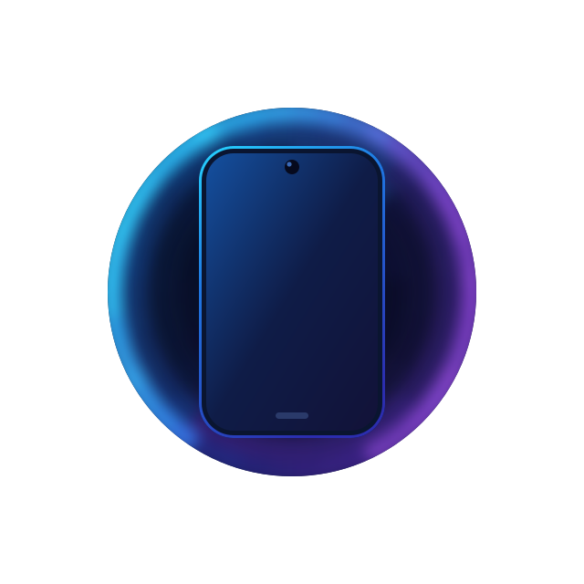

**简体中文** | [English](en/README.md) | [Türkçe](tr/README.md)

# Device Faker 📱

一个基于 Zygisk 的机型伪装模块，可以为不同的应用配置不同的设备型号。

## 官方网站 🌐

## 特性 ✨

- 🎯 **精确控制**: 为每个应用单独配置设备信息，仅对配置的应用生效，不影响其他应用
- 📁 **模板管理**: 多机型模板，便捷应用到多包名
- 🔄 **实时生效**: 修改配置后仅需重启应用，无需重启系统
- 🛡️ **安全可靠**: 基于 Zygisk 框架，模块化设计
- 📝 **简单配置**: 使用 TOML 格式配置文件，易于编辑
- 🎭 **统一执行流**: 无需选择模式，自动调度 JNI 字段伪装、COW 属性伪造与 companion 服务
- 🔒 **COW 属性引擎**: mmap 写时复制伪造系统属性，per-process 隔离、模块零驻留
- 🌐 **WebUI管理**: 提供图形化界面，方便配置管理

## WebUI 功能 🖥️

Device Faker 提供了现代化的 Web 管理界面

- 📋 **模板管理**: 创建、编辑和删除机型模板，批量应用到多个包名
- 📱 **应用管理**: 直观查看已安装应用及其配置状态，支持多用户应用显示
- 🖋️ **配置编辑**: 图形化界面编辑应用配置，支持模板应用和自定义配置
- 🌍 **多语言支持**: 简体中文、English、Türkçe

## 配置说明 ⚙️

详细的配置说明请参考 [配置文档](CONFIG.md)。

配置文件位于 `/data/adb/device_faker/config/config.toml`，使用 TOML 格式。修改配置后仅需重启对应应用即可生效，无需重启系统。

## 文档导航 📚

- [配置说明](CONFIG.md) - 应用/模板配置项、属性伪造机制与优先级
- [更新日志](CHANGELOG.md) - 各版本变更记录
- [官方网站](https://seyud.github.io/device_faker/) - 使用指南与常见问题

## 模板配置贡献 🎁

感谢社区成员的贡献，你也可以参与！Device Faker 配置仓库：

- 📦 [device_faker_config](https://github.com/Seyud/device_faker_config) - 贡献机型模板配置

贡献设备配置，帮助更多用户获得更好的机型伪装效果！

## 致谢 🙏

本项目在开发过程中参考了以下优秀项目：

- [zygisk-dump-dex](https://github.com/ri-char/zygisk-dump-dex) - 提供了 Rust 开发 Zygisk 模块的原型参考
- [zygisk-api-rs](https://github.com/rmnscnce/zygisk-api-rs) - 提供了 Zygisk API的 Rust 依赖支持
- [MiPushZygisk](https://github.com/wushidia/MiPushZygisk) - 提供了 Zygisk 机型伪装的方案参考

感谢这些项目的开发者！💖

---

**📱 让设备不为应用的机型限制所困！** 🚀

> 💝 如果这个模块对你有帮助，可以给个 ⭐ Star 支持一下
